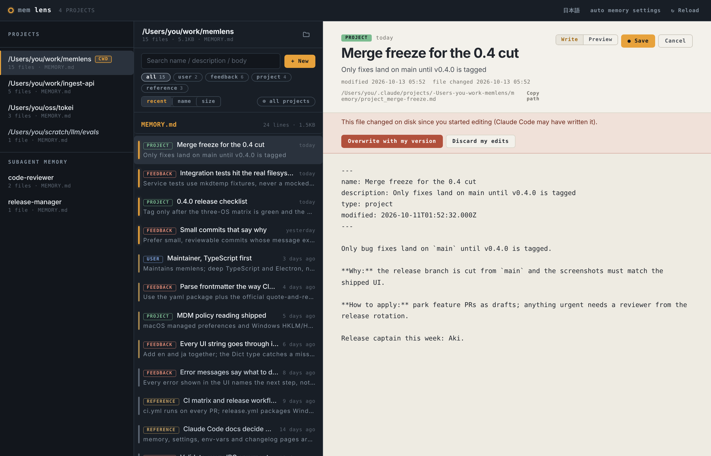

# memlens

[日本語版 README はこちら](./README.ja.md)

**memlens is a desktop lens over [Claude Code](https://www.anthropic.com/claude-code)'s auto memory** — the notes Claude writes to itself about you, your projects, and how you like to work. It turns the markdown files under `~/.claude/projects/<sanitized>/memory/` (and your subagents' memory under `~/.claude/agent-memory/`) into a fast three-pane instrument for reviewing, searching, curating, and pruning what your AI remembers.

Runs on **Windows, macOS, and Linux**. Built with Electron + React + TypeScript.


## Why

Claude Code accumulates memory automatically: a `MEMORY.md` index plus typed memory files per project. That memory shapes every future session, but it lives in hidden directories and is written by a machine. memlens exists so you can _see_ it — what's fresh, what's stale, what's load-bearing, and what deserves to be deleted — without spelunking through `~/.claude` by hand.

## Features

### Browse & read

- **Project rail** — every project under `~/.claude/projects/` with a memory directory, newest first, with a `cwd` badge on the one matching your working directory. The real project path comes from the `cwd` recorded in that project's session transcripts; when no transcript confirms it, memlens falls back to decoding the folder name and shows the guess in italics (the folder name can't tell whether a `-` was `/`, `-` or `.`). Custom directories (`autoMemoryDirectory`, cowork overrides) appear as `(custom)` virtual projects.
- **Subagent memory** — user-scope subagent memory (`memory: user`, stored in `~/.claude/agent-memory/<agent>/`) gets its own group in the rail.
- **Freshness traces** — each memory row carries a trace that dims with age. Age is taken from the `modified` timestamp Claude Code (v2.1.214+) writes into a memory's frontmatter, falling back to the file's mtime, so a sync or checkout that touches files doesn't make old memories look fresh; the detail view shows both. The fresh/faded boundary matches Claude Code's own staleness rule: memories older than a day are flagged in prompts as _point-in-time observations_ (`src/memdir/memoryAge.ts`), and memlens marks them with the same `point-in-time` chip when you open them.
- **Type taxonomy** — `user` / `feedback` / `project` / `reference` chips with live counts, matching the official memory type system, plus recency / name / size sorting. Frontmatter is parsed the way Claude Code parses it, including its retry for unquoted values such as `description: Testing policy: always hit a real DB`; frontmatter that still doesn't parse is flagged with ⚠ and shown as source, because Claude Code sees no name, description or type for that memory.
- **Hidden-content check** — flags invisible characters (zero-width spaces, bidi controls, tag characters, private-use code points) and tags that imitate Claude Code's own markup such as `<system-reminder>`. Claude Code (v2.1.284+) neutralizes both before a memory reaches Claude, so the file on disk and what Claude reads differ — and such content is often a trace of prompt injection from a web page or tool output.
- **Live reload** — `fs.watch` on the selected memory directory keeps the UI in sync while Claude Code writes.

### Search

- **In-project search** — instant header filtering plus debounced full-text body search with line numbers and excerpts.
- **All-projects search** — flip the `all projects` scope and one query sweeps every memory directory on the machine; hits are labeled by project and open with a click.


### Curate

- **Load-budget meter** — Claude Code loads only the first **200 lines / 25 KB** of `MEMORY.md` (`src/memdir/memdir.ts`). memlens measures your index against that budget with two gauges — like Claude Code v2.1.211+, measured on the content that actually loads (frontmatter and block-level HTML comments stripped first) — and warns at 90%. Over the limit, it draws the **cut line** where Claude Code stops reading, dims everything below it, and repeats Claude Code's own advice: rewrite the index to under 140 lines.
- **Index check** — reviews `MEMORY.md` against the official index rules: entries over ~200 characters (each entry should be one line under ~150), pointers to memory files that don't exist, memory files the index doesn't point to (one click adds the missing pointers), and frontmatter in the index.
- **Create** — guided dialog with per-type hints and the officially recommended body structure for `feedback` / `project` memories (\*rule → **Why:** → **How to apply:\***). Like Claude Code's own two-step save, it can also add the one-line pointer `- [Title](file.md) — hook` to `MEMORY.md`, with a preview and a warning when the line runs long.
- **Edit** — in-place editor with a Write / Preview toggle, dirty-state save (`Ctrl/Cmd+S`), and Escape to cancel. If Claude Code writes the file while you're editing, memlens says so right away and won't silently overwrite it — you choose to keep your version or discard your edits. Saves stamp `modified` in the frontmatter the way Claude Code does (only in files that already have frontmatter) and keep the file's line endings and BOM. Unsaved edits are guarded when you switch documents or close the window.
- **Rename / delete** — safe by construction: the top-level `MEMORY.md` entrypoint can be neither renamed nor deleted, collisions are refused, and filenames are validated against the strictest (Windows) rules on every OS so synced memory dirs stay portable. Renaming can update the index's links to the file, and deleting can remove its pointer.
- **Copy path / reveal** — copy the absolute path, or jump to Explorer / Finder / your file manager.




### Understand your setup

- **Settings inspector** — shows the resolved auto-memory configuration and _why_: which layer decided each value (env var, safe mode, managed policy, `--settings` flag, or `~/.claude/settings.json`), whether an env var came from your shell or from a settings file's `env` block, and which managed source supplied the policy.
- **Bilingual UI** — English / 日本語, one click.

## Install

Grab the latest build for your OS from [Releases](https://github.com/kongyo2/memlens/releases):

| OS      | Artifact                         | Notes                                                                                                        |
| ------- | -------------------------------- | ------------------------------------------------------------------------------------------------------------ |
| Windows | `memlens-Setup-<version>.exe`    | Per-user NSIS installer, no admin rights needed. SmartScreen may warn (unsigned) — "More info → Run anyway". |
| macOS   | `memlens-<version>-<arch>.dmg`   | Unsigned: right-click → Open on first launch, or `xattr -cr /Applications/memlens.app`.                      |
| Linux   | `memlens-<version>-x64.AppImage` | `chmod +x` then run. A `.deb` is also published for Debian/Ubuntu.                                           |

memlens needs an existing Claude Code installation with auto memory enabled — it only reads and writes files in directories Claude Code already manages.

## Keyboard shortcuts

| Shortcut       | Action                     |
| -------------- | -------------------------- |
| `Ctrl/Cmd + F` | Focus search               |
| `Ctrl/Cmd + N` | New memory                 |
| `Ctrl/Cmd + R` | Reload                     |
| `Ctrl/Cmd + S` | Save (while editing)       |
| `Esc`          | Cancel edit / close dialog |

## How auto memory works (primer)

- Each project's memory lives at `~/.claude/projects/<project>/memory/`, where `<project>` is derived from the canonical git root (worktrees share one directory) and sanitized for the filesystem; paths longer than 200 chars get a hash suffix.
- `MEMORY.md` is the index — loaded into every session, truncated at 200 lines / 25 KB.
- Individual memories are markdown files with `name` / `description` / `type` frontmatter (plus `modified` from v2.1.214). The four types capture context _not derivable_ from the repo: who you are (`user`), guidance you've given (`feedback`), ongoing work (`project`), and pointers to external systems (`reference`).
- Memories age: Claude Code annotates anything older than a day as a point-in-time observation.

memlens mirrors the official implementation for all of this (path sanitization, index limits, type parsing, staleness), so what you see is what Claude Code sees. See the official [memory documentation](https://code.claude.com/docs/en/memory) for the full story.

## Configuration

memlens has no config file of its own — it reads the same env vars and `settings.json` that Claude Code does, so whatever your CLI sees is what the app sees.

Environment variables (read at process start):

| Variable                             | Effect                                                        |
| ------------------------------------ | ------------------------------------------------------------- |
| `CLAUDE_CONFIG_DIR`                  | Overrides `~/.claude` as the config home.                     |
| `CLAUDE_CODE_REMOTE_MEMORY_DIR`      | Overrides the memory base dir (used by remote/cowork setups). |
| `CLAUDE_CODE_DISABLE_AUTO_MEMORY`    | Truthy → auto-memory OFF; falsy → forced ON.                  |
| `CLAUDE_CODE_SIMPLE`                 | Truthy → auto-memory OFF (matches CLI `--bare`).              |
| `CLAUDE_CODE_REMOTE`                 | Truthy + no `REMOTE_MEMORY_DIR` → auto-memory OFF.            |
| `CLAUDE_CODE_SAFE_MODE`              | Truthy → auto-memory OFF (matches CLI `--safe-mode`).         |
| `CLAUDE_CODE_PROJECT_DIR_NAME`       | With `CLAUDE_CONFIG_DIR`: names the `projects/` directory.    |
| `CLAUDE_COWORK_MEMORY_PATH_OVERRIDE` | Highest-precedence override for `autoMemoryDirectory`.        |
| `CLAUDE_SETTINGS_PATH`               | Path to a `--settings`-style overlay JSON.                    |
| `CLAUDE_CODE_MANAGED_SETTINGS_PATH`  | Overrides the managed-settings directory (`policy` layer).    |

Variables in a settings file's `env` block count too, applied the way Claude Code applies them: user, then `--settings`, then managed policy, each overriding your shell. `CLAUDE_CODE_PROJECT_DIR_NAME`, `CLAUDE_CODE_REMOTE` and `CLAUDE_CODE_SAFE_MODE` are read only from the real environment. `CLAUDE_CODE_PROJECT_DIR_NAME` is ignored without `CLAUDE_CONFIG_DIR` and must be 1–64 letters, digits, `-` or `_`.

Settings file precedence (re-read on every refresh):

1. Managed policy — by default the first of these that sets a policy key: MDM (the macOS `com.anthropic.claudecode` managed preferences or the Windows `HKLM\SOFTWARE\Policies\ClaudeCode` registry key), then `managed-settings.json` + `managed-settings.d/*.json`, then the Windows `HKCU` key. With `managedSourcesBehavior: "merge"`, the admin sources are combined.
2. `CLAUDE_SETTINGS_PATH` (the `flag` layer)
3. `~/.claude/settings.json` (user)

Keys honored by memlens: `autoMemoryEnabled` (boolean), `autoMemoryDirectory` (string, `~/` expansion supported), `env`. memlens has no working directory, so it doesn't read a repository's `.claude/settings.json` or `.claude/settings.local.json`.

## Development

Requirements: Node.js **>= 22.12**.

```sh
git clone https://github.com/kongyo2/memlens.git
cd memlens
npm ci

npm run dev          # Electron + Vite dev server (hot reload)
npm test             # Vitest (add -- --run for one-shot)
npm run typecheck    # TypeScript project references
npm run lint         # oxlint, warnings as errors (compact output)
npm run lint:pretty  # the same, human-readable
npm run lint:fix     # apply oxlint's safe fixes
npm run format       # oxfmt --check
npm run format:fix   # oxfmt --write

npm run build        # build renderer/main/preload bundles
npm run build:win    # package a Windows installer into ./release/
npm run build:mac    # package macOS dmg/zip (arm64 + x64)
npm run build:linux  # package AppImage + deb
```

### Project structure

```
src/
  main/        Electron main process
    services/  settings + MDM resolution, memory fs ops, index check,
               search, watcher, git-root canonicalization,
               path sanitization, transcript-based project paths
    ipc/       ipcMain handlers (validated at the boundary)
  preload/     contextBridge — the only bridge renderer ↔ main
  renderer/    React UI (three-pane app, i18n en/ja, components)
  shared/      zod schemas, IPC channel names, API contract types
```

Security posture: the renderer runs with Chromium's sandbox and talks to the filesystem only through the typed preload API; every path is validated against the allowed memory roots in the main process; writes check that the file still holds what you started editing; production builds get a strict CSP; external links open in the system browser only for http/https/mailto; a second launch focuses the existing window instead of opening another editor on the same files.

### Releasing

`Actions → Release → Run workflow` with a version like `v0.4.0`. The workflow lints, type-checks, and tests on **Windows, macOS, and Linux**, packages all three platforms, and publishes a GitHub Release with every artifact. CI runs the same three-OS test matrix on every PR.

## License

MIT — see [LICENSE](./LICENSE).

memlens is an independent third-party tool. It is not affiliated with or endorsed by Anthropic. "Claude" and "Claude Code" are trademarks of Anthropic, PBC.
